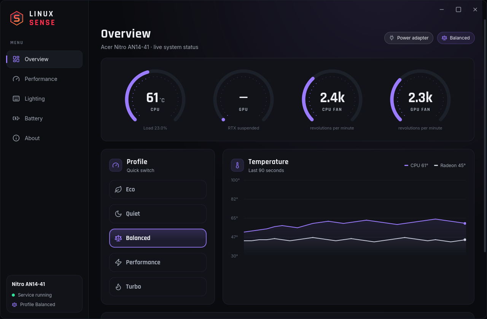
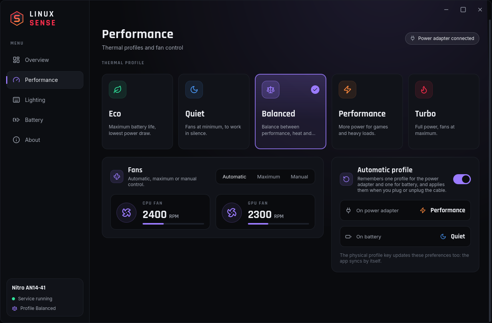

<p align="center"></p>

# Linux Sense

A control panel for **Acer Nitro** laptops on Linux, an alternative to NitroSense.
It was built on an Acer Nitro 14 (AN14-41) running Fedora 44 KDE with kernel 7.2.


## Screenshots

| Overview | Performance |
|---|---|
|  |  |

## Features

- **Thermal profiles**: Eco, Quiet, Balanced, Performance and Turbo, kept in sync with the laptop's physical profile key
- **Fans**: automatic, maximum or manual, with live RPM readings
- **4-zone RGB keyboard**: per-zone colors and effects, with an animated preview
- **Battery**: 80% charge limit, calibration, USB charging while powered off, health and runtime
- **Automatic profile**: one profile for the power adapter and one for battery
- **N key** on the keyboard opens the app
- **Multilingual interface**: English, Italian, Spanish, French, German and Portuguese, following the system language

## How it works

Linux Sense is made of three parts:

| Path | Contents |
|---|---|
| `app/` | User interface (Python + PySide6/QML), fonts and icons |
| `daemon/` | Root service `linux-sense.service`: socket `/run/linux-sense.sock`, line-based JSON |
| `driver/` | `linuwu_sense` 25.701 driver for DKMS with local patches (`linux-sense.patch`) |
| `system/` | hwdb rule for the N key and the unit that unloads the driver on shutdown |
| `scripts/` | KDE shortcut registration |
| `logo/` | Logo generated with `vectorcraft-cli` (`build_logo.py`) and exported files |

The daemon talks to the kernel driver through sysfs and exposes a small JSON
protocol over a Unix socket. The app is a QML front end that only talks to that
socket, so the UI never needs root.

## Requirements

- An Acer Nitro or Predator laptop supported by the `linuwu_sense` driver (tested on Nitro AN14-41)
- Fedora or a similar distribution with `dnf`, DKMS and kernel headers
- KDE Plasma for the shortcut, brightness popup and key remapping (the app itself is Qt)
- Packages: `python3-pyside6`, `kernel-devel`, `dkms`, `gcc`, `make`

## Installation

```bash
sudo ./install.sh
```

The script:

- builds and installs the driver with DKMS (it rebuilds itself on every new kernel) and blacklists `acer_wmi`;
- installs the service, the app, icons and menu entry in `/opt/linux-sense`;
- remaps the N key and binds it to opening the app in KDE.

You can run it again to update after a change.

## Usage

Open **Linux Sense** from the application menu, or press the **N** key.
The app shows the current profile, temperatures, fan speeds and battery state.
Changes are applied immediately; there is no save button.

If the app says the service is unreachable:

```bash
sudo systemctl start linux-sense
sudo systemctl status linux-sense
```

## Languages

The interface follows the system language. These translations ship with the app:

| Language | Code | File |
|---|---|---|
| English (source) | `en` | built in |
| Italian | `it` | `app/translations/it.json` |
| Spanish | `es` | `app/translations/es.json` |
| French | `fr` | `app/translations/fr.json` |
| German | `de` | `app/translations/de.json` |
| Portuguese | `pt` | `app/translations/pt.json` |

If the system language has no translation file, the app falls back to English.

Translations are plain JSON files: the key is the English source string, the value
is the translated one. To add a language, copy `app/translations/it.json`,
translate the values, and save it as `app/translations/<language>.json`
(`nl.json`, `pl.json`, ...). Missing keys fall back to English, so a partial file
is safe.

Useful while testing:

```bash
LINUX_SENSE_LANG=it ./linux-sense     # force a language
```

## Technical notes

- The profile is read from and written to the `acer-wmi` platform-profile handler. The service propagates it to `amd-pmf`.
  The legacy `/sys/firmware/acpi/platform_profile` interface returns `custom` when the two handlers disagree.
- On battery the firmware only accepts Eco and Balanced.
  In Eco and Quiet the fans are always managed by the firmware.
- The N key sends scancode `0xf5`, which by default becomes code 425 and cannot be used by KDE.
  It is remapped to `prog1` (XF86Launch1).
- Keyboard brightness (Fn+F11 / Fn+F12): the firmware changes brightness by ±25 with no clamping.
  Below 0 or above 100 the value wraps around (8 − 25 = 239) and the keyboard misbehaves.
  The service intercepts the two keys, remapped by hwdb to `kbdillumdown`/`kbdillumup`, and applies 0–25–50–75–100 levels with off at the minimum, like NitroSense.
  Without the remapping, the generic Acer rule in systemd would turn Fn+F12 into "screen brightness down".
- Reading the Acer profile or the battery settings costs one WMI call to the firmware (~9 ms).
  The service caches them and uses sysfs notifications for the profile instead of polling continuously.

### Driver patch

The driver comes from [Linuwu-Sense](https://github.com/0x7375646F/Linuwu-Sense), in the version bundled with [DAMX](https://github.com/PXDiv/Div-Acer-Manager-Max).
The changes are:

- `strncpy` replaced by `memcpy`, because the function was removed from kernel 7.x;
- the `Nitro AN14-41` model added to the DMI table, with the same settings as the AN16-41.

## Troubleshooting

- **Fans do not react**: check `lsmod | grep linuwu_sense` and that `acer_wmi` is not loaded.
- **Profile switches back by itself**: change the power source and wait a few seconds; the daemon reconciles external changes from `tuned-ppd`.
- **No keyboard brightness popup**: the `uleds` module must be loaded and the daemon running.
- **App opens but shows no data**: `sudo systemctl status linux-sense` and check `/run/linux-sense.sock` exists.

## License

Linux Sense is released under the [GNU GPL v3.0](LICENSE).

## Credits

- Linuwu-Sense driver (GPL-2.0-or-later)
- DAMX starting project (GPL-3.0)
- [Lucide](https://lucide.dev) icons (ISC)
- Rajdhani and Inter fonts (SIL OFL)

Every third-party component keeps its own license.
